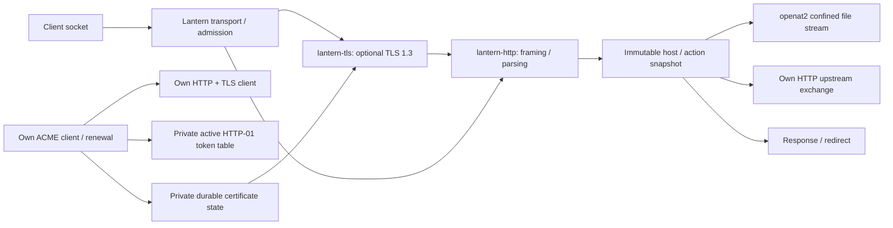

# Research and architecture

Reviewed 2026-10-15. This project combines independent implementations and measured
behavior with deliberately bounded scope. The HTTP and TLS projects contain their
own protocol research, tests, and security limits. This document records the server
integration decisions and links to primary sources.

## Language selection

Haskell is unusual for an operations-facing webserver while having native
compilation, algebraic data types and a runtime suited to concurrent I/O. GHC's
[RTS guide](https://ghc.gitlab.haskell.org/ghc/doc/users_guide/runtime_control.html)
describes its scheduling, storage and runtime controls. Lantern uses bounded
connection threads and two runtime capabilities by default. Memory management
reduces one class of parser hazards; it does not establish protocol correctness,
constant-time behavior or resource bounds. Those need explicit code and tests.

Other candidates were considered. [Gleam](https://gleam.run/frequently-asked-questions/)
and its [externals model](https://gleam.run/documentation/externals/) offer a typed
BEAM approach, useful for supervised applications; here we wanted a native
executable and direct control over the wire layer. [Odin's overview](https://odin-lang.org/docs/overview/)
explicitly uses manual memory management, which would add a different memory-safety
review burden while writing two new protocol parsers. [ATS's stateful-view research](https://arxiv.org/abs/1810.12190)
is attractive for reasoning about resources, but that would shift this project
into proving/maintaining a larger low-level implementation. Selecting Haskell is
an engineering judgment for this project, not a universal ranking.

## Usability and immutable configuration

[Caddy's architecture](https://caddyserver.com/docs/architecture) treats a
configuration as an immutable unit whose replacement is provisioned before use.
Lantern follows that useful principle with a strict Lanternfile parser, validated
site actions and a single snapshot swap. It does not reproduce Caddy's plugin/API
architecture. Running requests use one route snapshot; failed reloads leave the
working state intact. Listeners and admission limits stay fixed until restart.

[Caddy's automatic HTTPS](https://caddyserver.com/docs/automatic-https) establishes
certificate lifecycle as an essential operator convenience. Lantern implements
HTTP-01 issuance and renewal itself, instead of making manual certificate copying
the only public deployment path. Domain ownership, CA reachability and persistent
key state remain operational prerequisites. Its simpler profile does not claim
Caddy's breadth, maturity or zero-dependency distribution.

## Three projects and their boundaries

The HTTP library depends only on base/bytestring/time and owns incremental parsing,
framing, chunk decoding and serialization. The TLS library owns the protocol
state/record/key-schedule layers. Crypton provides primitives and PKIX verification;
we do not rewrite AES, SHA-256, X25519 or RSA. The server owns configuration,
resources, routes, file confinement, proxy policy, ACME and lifecycle. Small
parser/concurrency/MIME helpers and OS interfaces are retained, rather than calling
an existing HTTP/TLS server or ACME executable.

## HTTP, proxying and resource controls

The protocol library's [RFC 9112 research](https://git.freifick.net/slop/lantern-http/-/blob/main/docs/research.md)
explains strict framing and connection poisoning. A proxy must treat the upstream
as another untrusted parser boundary: strip hop fields, replace forwarding identity,
regenerate request lengths, validate response framing before committing headers,
and close on truncated streams. Lantern opens a fresh upstream connection for each
request and never retries one after sending bytes. This intentionally trades away
pooling performance to reduce cross-request state in the first implementation.

Metadata limits do not alone bound heap usage. A declared request size can be
small per connection and large across a server. Lantern therefore reserves body
memory globally, in addition to per-request caps and connection admission. Chunked
requests reserve their full configured cap. Slow headers, bodies and complete
responses have absolute deadlines; receiving one byte does not indefinitely
extend the complete-operation deadline. Streaming responses retain bounded pieces
and respect socket backpressure. A supervisor adds independent process limits.

## Filesystem confinement

Linux [openat2](https://man7.org/linux/man-pages/man2/openat2.2.html) supplies
resolution constraints at open time. Checking a canonical path and then opening
it by name leaves a replacement race; Lantern instead opens relative to the
configured directory with BENEATH/NO_SYMLINKS/NO_MAGICLINKS. It then requires a
regular file and streams from that descriptor. A tiny C wrapper is the only
non-Haskell implementation. Configured roots are administrator-managed; this is
not a sandbox against intentionally published hard links or mount contents.
The regression fixture repeatedly swaps a path between safe content and an
outside symlink while making requests.

## ACME and cryptographic glue

[RFC 8555](https://www.rfc-editor.org/rfc/rfc8555.html) provides the ACME resource
workflow: directory, replay nonce, signed account/order, authorization challenge,
finalization and certificate retrieval. Lantern implements HTTP-01 only. It pins
resource origins to the configured CA, bounds polling/JSON, retries a bad nonce
with a fresh one, and persists rate backoff. Active tokens are held only during
authorization. Keys are private and separately scoped from website content.

[RFC 7515](https://www.rfc-editor.org/info/rfc7515/) defines the JWS signature
envelope; [RFC 7638](https://www.rfc-editor.org/info/rfc7638/) defines the canonical
JWK thumbprint used in key authorization. Our JSON encoder sorts the RSA JWK's
ASCII fields, uses unpadded base64url, and signs the exact protected/payload bytes
through a blinded Crypton RSA operation. CSRs and server credentials are handled
by the TLS project's PKI glue.

Renewal uses actual certificate dates rather than assuming a fixed validity
period. Writes use private temporary files, fsync and atomic rename. A complete
new chain/key pair is loaded before publication, then credentials are swapped
for new handshakes. Failed renewal preserves the active certificate; it does not
make a partially written key pair live. The same state directory is process-locked.
Configuration and certificate updates retain coherent snapshots independently.

## Evidence and limits

The [Let's Encrypt staging documentation](https://letsencrypt.org/docs/staging-environment/)
recommends staging for integration and distinguishes its untrusted roots from
production trust. A real staging order, cached restart, forced renewal and
verified HTTPS response passed here; no publicly trusted production issuance was
attempted. A test-only root was passed to curl without changing system trust.
Temporary DNS/Caddy challenge routing was removed after the test.

For repeatable offline checks, our local CA fixture verifies RSA JWS signatures,
nonce freshness, CSR signature/SANs, and the actual challenge body fetched from
Lantern. It tests renewal and failure/backoff behavior. This complements, rather
than simulates proof from, public-CA interoperability. HTTP tests cover malformed
framing, forwarding spoofing, bodies, concurrency, symlink races, deadlines,
admission and reload rejection. The TLS project tests against real OpenSSL.

[Benchmarks](benchmarks.md) publish the complete local observations, including the
fact that Caddy was faster. They are not WAN/TLS measurements or proof of security.
The server remains experimental: no independent audit, full TLS feature profile,
formal state-machine proof, coverage-guided fuzz campaign, or boot-tested NixOS
service is claimed. See [security.md](security.md) for the exact trust boundary.

## HTTPS upstream authentication (2026-10-16)

[RFC 9110 section 4.3.4](https://www.rfc-editor.org/rfc/rfc9110.html#section-4.3.4)
requires an HTTPS client to authenticate the configured origin's service identity.
Lantern now reuses its independent TLS client for reverse proxy upstreams: the
operator-selected endpoint supplies both the connection destination and TLS
reference name. Host headers use the same endpoint, with IPv6 brackets. Incoming
Host/forwarding values cannot change the TLS reference identity or roots.

The client uses the SAN-only policy from
[RFC 9525](https://www.rfc-editor.org/rfc/rfc9525.html), with exact IP SAN matching
and one-label complete DNS wildcards. Literal IP addresses omit SNI as required by
[RFC 6066 section 3](https://www.rfc-editor.org/rfc/rfc6066.html#section-3).
Crypton still supplies PKIX signature/path/time/purpose verification. Its pinned
1.6.14 default name hook was inspected and replaced because it permits Common Name
fallback and mishandles IP-only SANs. A separate optional proxy CA bundle supports
private origins without altering ACME or system trust. Loading it before snapshot
publication makes a failed trust rotation preserve a working proxy.

Independent Python/OpenSSL peers exercise RSA/ECDSA authenticated proxying,
streaming/chunked responses, request echo, wrong names, unknown roots, expiry,
TLS-version rejection and failed trust rotation. Library interoperability also
checks CN-only rejection, IP-only SANs, wildcard depth and captured SNI.

## TLS group negotiation follow-up (2026-10-16)

The independent TLS project now implements X25519/P-256 ECDHE and one retry in
both roles, including client-side opaque cookies and the synthetic retry
transcript. Its research references the current
[RFC 9846](https://datatracker.ietf.org/doc/html/rfc9846) text alongside RFC 8446.
Crypton provides the curve operations. The server preserves retry-immutable
ClientHello fields; the client rejects an already offered/unsupported requested
group, repeated retry and changed final parameters. See the TLS project's
research/security notes and independent OpenSSL/adversarial fixtures. Lantern's
HTTP and HTTPS proxy checks exercise the newly pinned P-256 paths end to end.

## Static conditional transfers and byte ranges (2026-10-16)

The independent HTTP library now owns entity-tag/date parsing, precondition order,
range normalization and multipart lengths, informed by
[RFC 9110 sections 8.8, 13, 14 and 15.3.7](https://www.rfc-editor.org/rfc/rfc9110.html).
Lantern obtains metadata from the same confined descriptor it streams, not from
an independent path lookup. Weak tags hash metadata, representation headers and
file identity with Crypton's SHA-256 primitive; this is not a file-content hash.
It avoids pre-reading a large file, and intentionally never supplies strong
If-Range evidence. Last-Modified is clamped to the response's current time.

The chosen range policy coalesces overlaps/adjacency, retains the first-requested
order of disjoint groups, and caps elements at 16. Multipart framing is generated
with a random boundary and exact length, without buffering file data. Configured
content coding disables ranges. The library can evaluate strong validators when
a caller has them; this file server chooses conservative metadata validators.

Independent Python HTTP/email MIME parsers verify status, framing and byte slices.
Tests also cover enormous decimals, empty files, conditional precedence, repeated
requests after 304/multipart, same-size/same-mtime atomic replacement, confinement,
concurrent replacement and verified TLS ranges. These checks do not authorize
in-place mutation of a published file or prove metadata tags collision-free.

## Directory URL canonicalization (2026-10-16)

[RFC 9110 section 15.4.9](https://datatracker.ietf.org/doc/html/rfc9110#section-15.4.9)
provides the permanent-redirect semantics. A literal trailing slash is needed for
browser relative-link resolution, even if a decoded path already ends in an encoded
slash. Lantern adds it to the original escaped path, before its unchanged query.
The generated Location has no authority and never uses a client-supplied host.

The directory decision comes from an openat2-confined descriptor. An O_PATH probe
for a search-only directory keeps the same confinement flags; the
[Linux openat2 manual](https://man7.org/linux/man-pages/man2/openat2.2.html) describes
that policy's path-resolution guarantees. No extra directory lookup is added to a
successful ordinary-file request. The directory descriptor is closed before the
redirect, and a subsequent slash request independently opens its regular index
under the same policy. No directory listing or unsafe path fallback was added.

During Unicode testing, the C locale exposed a locale-dependent FFI conversion
that could discard characters after path validation and alias a hidden filename.
The separately verified UTF-8 fix pins filesystem encoding at CLI/config startup
and passes explicit UTF-8 bytes to the shim. Synthetic C-locale tests verify exact
Unicode names/config/roots and prevent hidden/dot-prefix aliases. Directory tests
also check actual relative-asset requests, canonical HEAD framing and race behavior.

## ACME certificate validity (2026-10-16)

[RFC 5280 section 4.1.2.5](https://www.rfc-editor.org/rfc/rfc5280.html#section-4.1.2.5)
defines both validity bounds. A successful authenticated ACME download is not
sufficient evidence that its leaf is usable now. Lantern previously checked only
expiry, and the fixture reproduced activation of a correct-key certificate whose
notBefore was tomorrow. Activation and cached startup now check both bounds,
retaining the existing conservative rejection at the expiry second. Invalid
renewal leaves the disk chain and active credentials intact and persists backoff.
The CA fixture checks this rollback, then places the synthetic future-dated chain
in the private cache and verifies startup acquires a usable replacement before
opening HTTPS. This is leaf date validation, not a claim of full issued-chain
verification. No cryptographic primitives are reimplemented.
